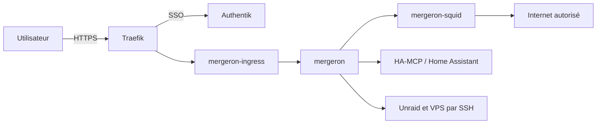

# Mergeron

Mergeron est un espace collaboratif auto-hébergé pour piloter les projets,
les conversations, les documents et les agents de développement. Il s’installe
avec Docker Compose ou les formulaires Unraid. Codex est le moteur de
développement actuellement intégré, pas le nom de la plateforme.

L’icône graphite-cuivre est commune au web et à la PWA. Son original vectoriel
se trouve dans [`web/public/mergeron-icon.svg`](web/public/mergeron-icon.svg).
L’image officielle est `ghcr.io/maxhugit/mergeron:latest`. Les conteneurs sont
nommés `mergeron`, `mergeron-ingress` et `mergeron-squid`. Les variables de
configuration, volumes et clés de stockage existants sont conservés.
La [migration vers Mergeron](docs/migration-mergeron.md) décrit les changements
à reporter dans les formulaires Unraid ou une installation Compose existante.

Il s’agit d’une adaptation du projet
[`LimLLL/mergeron`](https://github.com/LimLLL/mergeron), publiée sous
licence AGPL-3.0-or-later.

## Fonctions principales

- projets avec participants, workspaces, connaissances et connecteurs dédiés ;
- conversations Codex regroupées par projet et espace de travail ;
- chat simple utilisant directement l’API OpenAI ;
- tableaux de tâches, planning, sous-tâches et agents Codex ;
- livrables documentaires versionnés, validables et rattachés aux tâches ;
- gestion des personnes, chef de projet et groupes internes au projet ;
- automatisations rattachées aux projets ;
- terminaux persistants ;
- navigation et modification des fichiers de `/workspaces` et `/appdata` ;
- consultation des PDF et édition des documents Office avec OnlyOffice ;
- intégrations MCP, notamment Home Assistant ;
- isolation des données selon le rôle et la participation aux projets ;
- accès SSH à Unraid et au VPS avec des clés montées en lecture seule ;
- interface adaptée aux ordinateurs et aux mobiles/PWA.

## Architecture de production

La plateforme utilise trois conteneurs :

1. `mergeron` exécute l’interface et le moteur Codex ;
2. `mergeron-ingress` protège et transmet les requêtes entrantes ;
3. `mergeron-squid` filtre les accès HTTP/HTTPS sortants.



Les formulaires Docker standard d'Unraid se trouvent dans
[`deployment/docker-man`](deployment/docker-man). La définition Compose reste
disponible dans [`deployment/compose.unraid.yml`](deployment/compose.unraid.yml).
Les détails des réseaux et des protections sont documentés dans
[`docs/architecture-unraid.md`](docs/architecture-unraid.md).

## Reconstruire la plateforme

Le [sommaire de la documentation](docs/README.md) permet de comprendre le dépôt
et de reconstruire toute la plateforme. Le
[comparatif des modes d’installation](docs/choisir-mode-installation.md) explique
les différences de gestion des réseaux, mises à jour et retours arrière. La
[procédure DockerMan](docs/installation-unraid-dockerman.md) est recommandée
pour une gestion native dans l'onglet Docker. La
[procédure Compose](docs/installation-unraid.md) reste disponible. Elles couvrent
la préparation des secrets, les réseaux, Traefik, Authentik, OnlyOffice, SSH et
MCP.

## Construction de l’image

Chaque modification de la branche `main` construit et publie :

```text
ghcr.io/maxhugit/mergeron:latest
ghcr.io/maxhugit/mergeron:sha-<commit>
```

Pour la production, un tag immuable `sha-...` est préférable à `latest`.

Le registre conserve automatiquement les 10 images les plus récentes portant
uniquement un tag `sha-*`. Les tags `latest`, `buildcache` et les éventuels tags
de version sont protégés. Le nettoyage est exécuté chaque semaine et peut être
lancé manuellement en mode simulation depuis GitHub Actions.

## Évolutions du projet d’origine

La synchronisation automatique avec le projet d’origine est désactivée. Ce fork
contient désormais des adaptations importantes pour Unraid, le mobile, les
fichiers, OnlyOffice, Authentik et la sécurité réseau. Une fusion globale de
l’amont présenterait trop de risques de régression.

Une évolution utile doit être reprise manuellement dans une branche dédiée,
avec lecture du diff, tests et validation avant intégration.

## Données exclues du dépôt

Ne jamais ajouter à Git les clés OpenAI, clés privées SSH, jetons internes,
identifiants OAuth/MCP, bases SQLite, conversations, espaces de travail ou
contenus d’`appdata`.

Consulter [`SECURITY.md`](SECURITY.md) avant toute modification du déploiement.
