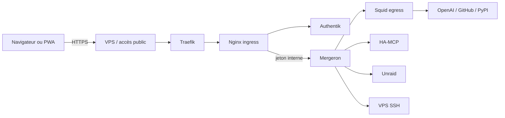

# Architecture Codex sur Unraid

## Vue d’ensemble

## Conteneurs

### `mergeron`

Application principale et moteur Codex. Aucun port n’est publié sur l’hôte.
L’application est joignable uniquement depuis Nginx sur le réseau interne.

Montages persistants :

| Montage | Usage | Accès |
|---|---|---|
| `/home/codex` | configuration, OAuth, MCP, base SQLite | lecture/écriture |
| `/workspaces` | espaces de travail | lecture/écriture |
| `/appdata` | configurations Unraid | lecture/écriture |
| `/app/logs` | journaux | lecture/écriture |
| `/home/codex/.ssh` | clés et configuration SSH | lecture seule |
| `/run/secrets/*` | jetons internes et clé OpenAI | lecture seule |

### `mergeron-ingress`

Passerelle Nginx entre Traefik et l’application. Elle est l’unique point de
contrôle Authentik, propage au navigateur les cookies de session renouvelés,
remplace tout en-tête `Authorization` fourni par le client et injecte le jeton
interne attendu par Mergeron.

Les exceptions machine-à-machine sont limitées au retour OAuth MCP et aux deux
routes OnlyOffice. Les contrôles applicatifs OnlyOffice restent obligatoires.

### `mergeron-squid`

Proxy Squid utilisé par les variables `HTTP_PROXY`, `HTTPS_PROXY` et
`ALL_PROXY`. Il refuse les adresses privées et n’autorise qu’une liste définie
de domaines Internet.

## Réseaux

| Réseau | Type | Membres | Fonction |
|---|---|---|---|
| `mergeron-isolated` | bridge interne | les trois conteneurs | trafic privé entre les composants |
| `mergeron-external` | bridge | Squid | sortie Internet du proxy |
| `mergeron-admin` | bridge `/28` | application | SSH, MCP et services administratifs |
| `net_standard` | bridge externe | Nginx, Traefik, Authentik | entrée HTTPS et SSO |

`mergeron-isolated` possède `internal: true` : il ne fournit pas de route Internet.

## Flux entrant

1. Traefik termine TLS pour le domaine public choisi par l’administrateur.
2. Traefik transmet à `mergeron-ingress:8080`.
3. Nginx valide ou renouvelle la session auprès d’Authentik.
4. Une session absente ou expirée est redirigée vers le flux de connexion de
   l’outpost, puis vers l’URL initiale.
5. Nginx transmet vers `mergeron:8172` avec le jeton interne.

## Flux sortant

Les logiciels respectant les variables de proxy passent par Squid. Les domaines
autorisés sont définis dans `deployment/config/squid.conf`.

Le réseau `mergeron-admin` offre une route directe nécessaire aux connexions SSH et
aux services locaux. Il s’agit d’un compromis connu : Squid n’est donc pas un
pare-feu absolu pour un programme qui ignorerait volontairement le proxy.

## Durcissement Docker

- `privileged: false` ;
- aucun socket Docker ;
- `read_only: true` ;
- `cap_drop: ALL` ;
- `no-new-privileges:true` ;
- ressources CPU, mémoire et PID limitées ;
- répertoires temporaires en `tmpfs` avec `nosuid,nodev` ;
- profil seccomp spécifique pour le bac à sable Bubblewrap ;
- rotation des journaux Docker.
